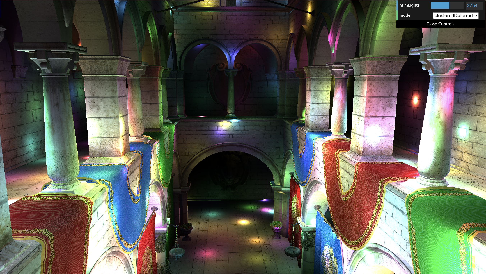
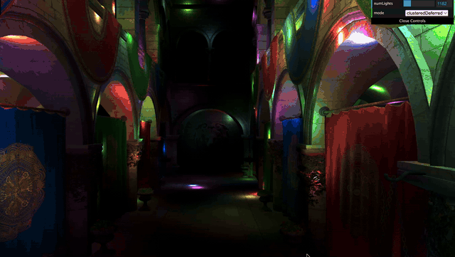
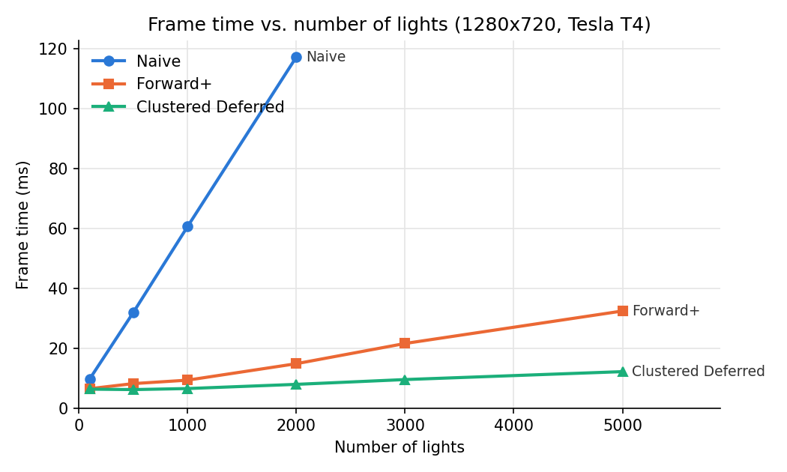
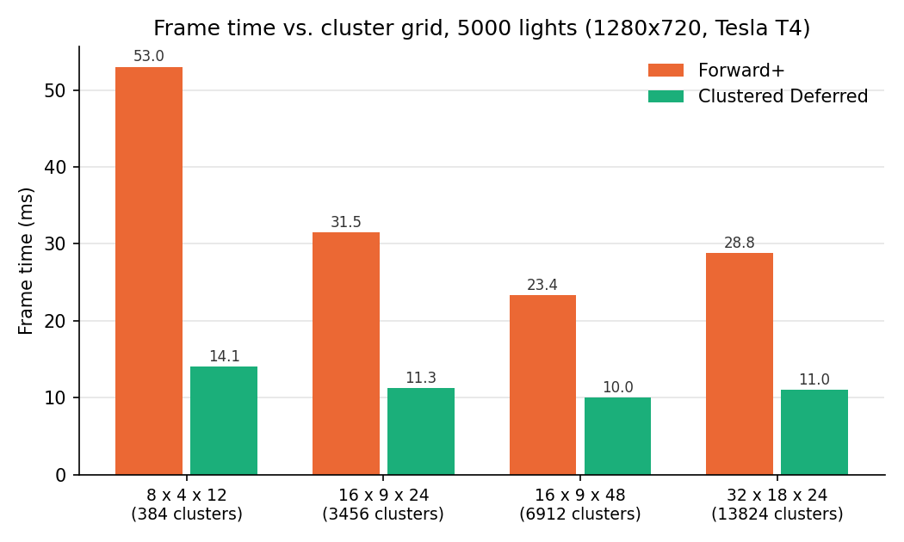

WebGL Forward+ and Clustered Deferred Shading
======================

**University of Pennsylvania, CIS 565: GPU Programming and Architecture, Project 4**

* Josh Kim
* Tested on: Ubuntu 22.04.5 LTS, Intel Xeon @ 2.30GHz (4 vCPUs), 15 GB RAM, NVIDIA Tesla T4 16 GB (Google Cloud VM)

### Live Demo

[Live Demo!](https://euikwang.com/Project4-WebGPU-Forward-Plus-and-Clustered-Deferred/)

### Demo Video/GIF

This project renders the Sponza scene lit by up to 5000 moving point lights in WebGPU, using three renderers: Naive, Forward+, and Clustered Deferred. Each light only reaches 2 units (`lightRadius`), so most lights have no effect on most of the scene. Forward+ and Clustered Deferred take advantage of this.

### Naive

A single forward pass in which every fragment adds up the contribution of every light. Its cost grows linearly with the number of lights.

### Forward+

A compute pass divides the view frustum into a 16 x 9 x 24 grid of clusters with logarithmically spaced depth slices. For each cluster it stores the indices of the lights whose radius overlaps it (up to 1023). Each fragment then finds its cluster from its screen position and depth and only evaluates those lights. The clustering pass adds some work every frame but cuts each fragment's light loop down to the nearby lights.

### Clustered Deferred

Clustered Deferred uses the same clustering pass, but splits rendering into two passes:

1. A G-buffer pass draws the scene without lighting and stores the albedo, normal and world position of the closest surface at each pixel.
2. A fullscreen pass reads the G-buffer and lights each pixel using its cluster's lights.

Lighting then runs once per visible pixel instead of once per drawn fragment, at the cost of three screen-sized textures.

## Performance Analysis
I stepped frames one at a time and timed each frame from submitting it until the GPU finished. Each number is the median of 40 frames (10 for naive) after 8 warm-up frames, averaged over two runs. The light movement and clustering compute passes are included.

### Number of Lights

| Lights | Naive (ms) | Forward+ (ms) | Clustered Deferred (ms) |
|-------:|-----------:|--------------:|------------------------:|
| 100    | 9.7        | 6.5           | 6.3                     |
| 500    | 31.9       | 8.2           | 6.2                     |
| 1000   | 60.6       | 9.3           | 6.5                     |
| 2000   | 117.2      | 14.8          | 7.9                     |
| 3000   | –          | 21.6          | 9.5                     |
| 5000   | –          | 32.4          | 12.2                    |

Naive slows down linearly with the number of lights because every fragment loops over every light. I stopped measuring it at 2000 lights. Forward+ is 3.9x faster than naive at 500 lights and 7.9x faster at 2000. It still slows down as lights are added because each cluster ends up holding more of them. Clustered Deferred slows down the least. Going from 1000 to 5000 lights added 23.1 ms to Forward+ but only 5.7 ms to Clustered Deferred.

### Number of Clusters

I changed the cluster grid constants in `shaders.ts` and measured each grid with 5000 lights.

| Grid (X x Y x Z) | Clusters | Forward+ (ms) | Clustered Deferred (ms) | Avg lights per cluster |
|---|---:|---:|---:|---:|
| 8 x 4 x 12   | 384   | 53.0 | 14.1 | 254 |
| 16 x 9 x 24  | 3456  | 31.5 | 11.3 | 162 |
| 16 x 9 x 48  | 6912  | 23.4 | 10.0 | 133 |
| 32 x 18 x 24 | 13824 | 28.8 | 11.0 | 151 |

The coarsest grid was the slowest. Fifteen of its clusters also hit the 1023-light limit, so some lights were dropped. Doubling the depth slices (16 x 9 x 48) gave the best result and even beat 32 x 18 x 24, which has twice as many clusters. A light reaches 2 units in every direction, so thinner slices shrink the light lists more than narrower tiles do. Forward+ gains more than Clustered Deferred because it runs the light loop for more fragments. More clusters also take more memory (14 MB for 3456 clusters and 57 MB for 13824).

### Forward+ vs. Clustered Deferred

**Is one of them faster?** Clustered Deferred was faster at every light count I measured. The gap also grows with more lights. It was 1.9x faster than Forward+ at 2000 lights and 2.7x faster at 5000.

**Is one of them better at certain types of workloads?** Clustered Deferred is better with many lights and a lot of overdraw. Forward+ is better with few lights or when memory bandwidth is limited. It also handles transparent objects and scenes with many different materials, which are hard to fit into one G-buffer layout.

**What are the benefits and tradeoffs?** Clustered Deferred lights each visible pixel exactly once. Its lighting cost depends on the number of pixels and not on how much geometry is drawn. The tradeoff is memory. My G-buffer takes 28 bytes per pixel (about 26 MB at 1280 x 720), and it is written and read every frame. Forward+ needs no extra textures and works with any material or transparency. However, it shades every fragment that gets drawn, even the ones that end up hidden.

**What causes the difference?** In Forward+ the light loop runs for every fragment that passes the depth test when it is drawn. If a closer surface is drawn over the same pixel later, that lighting work is wasted. In Clustered Deferred the G-buffer pass only does cheap work per fragment. The light loop then runs just once per pixel. The light loop is the expensive part and it gets slower as clusters fill up with lights. That is why the gap grows with the number of lights.

### Best and Worst Cases

**Forward+ (compared to naive):** The best case is many lights that each cover a small part of the view, so each cluster only holds a few. There are two worst cases. With few lights the clustering pass is extra work for little benefit. With lights packed into one area the nearby clusters hold most of the lights, and the loop becomes almost as long as the naive one.

**Clustered Deferred (compared to Forward+):** The best case is many lights and a lot of overdraw. The worst case is few lights and little overdraw. Then the extra G-buffer pass and its memory traffic cost more than they save.

### Credits

- [Vite](https://vitejs.dev/)
- [loaders.gl](https://loaders.gl/)
- [dat.GUI](https://github.com/dataarts/dat.gui)
- [stats.js](https://github.com/mrdoob/stats.js)
- [wgpu-matrix](https://github.com/greggman/wgpu-matrix)
